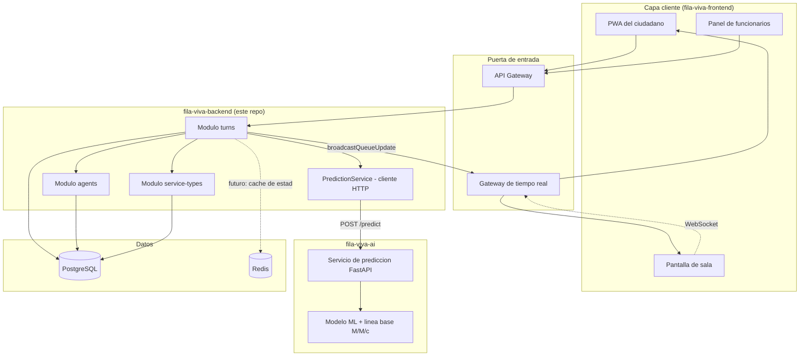

# Fila Viva — Backend

API central de **Fila Viva**, el sistema de predicción inteligente de tiempos de espera (caso de estudio: turnos en hospitales, bancos, universidades y oficinas de atención al público). Este repositorio es **uno de tres**:

| Repositorio | Qué hace | Estado |
|---|---|---|
| `fila-viva-backend` (este) | API core: turnos, funcionarios, tipos de trámite, tiempo real |
| `fila-viva-frontend` | PWA del ciudadano, pantalla de sala y panel de funcionarios | 🟡 |
| `fila-viva-ai` | Servicio de predicción (IA + teoría de colas) | |

> Este documento está escrito para dos lectores a la vez: una persona del equipo, y una IA generadora de código a la que se le vaya a pedir que continúe el proyecto. Por eso es más explícito de lo normal sobre decisiones, convenciones y pendientes.

---

## 1. Qué es Fila Viva

En una fila real, "turno 52" no dice cuánto tiempo real vas a esperar. Fila Viva calcula ese tiempo dinámicamente combinando:

- datos en tiempo real (personas delante, funcionarios activos ahora mismo),
- datos históricos (duración típica de ese trámite, por hora y día),
- un modelo de machine learning y una fórmula clásica de teoría de colas como comparación.

Este backend es el orquestador: recibe los turnos, conoce el estado de los funcionarios, le pregunta al servicio de IA (`fila-viva-ai`) cuánto va a demorar, y empuja esa respuesta en tiempo real a quien está esperando (`fila-viva-frontend`).

---

## 2. Estado del avance — qué SÍ y qué NO está hecho

**Hecho en este avance:**
- Estructura del proyecto en NestJS + TypeScript, modular y lista para crecer.
- Conexión a PostgreSQL vía TypeORM, con `synchronize` activo solo en desarrollo.
- Entidades: `Turn`, `Agent`, `ServiceType`.
- CRUD básico de `agents` y `service-types`.
- Flujo completo de `turns`: crear turno → contar personas delante → contar funcionarios activos → pedirle la predicción al servicio de IA → devolver todo junto → avisar por WebSocket.
- Cliente HTTP hacia `fila-viva-ai` (`PredictionService`), con una estimación clásica de respaldo si el servicio de IA todavía no está levantado (para poder seguir probando el backend sin depender de que la IA ya exista).
- Gateway de WebSocket (`TurnsGateway`) con salas por tipo de trámite.
- Swagger en `/docs`.
- Docker Compose con PostgreSQL y Redis para desarrollo local.
- Un test unitario de ejemplo (`turns.service.spec.ts`) que valida el flujo de creación de un turno.

**Explícitamente NO hecho todavía (para las próximas semanas):**
- No hay autenticación ni roles (Cognito/JWT). Todos los endpoints están abiertos.
- No hay bus de eventos (Kafka / Redis Streams). Los `TODO` en el código marcan dónde va a ir cada evento (`turn.created`, `agent.status.changed`, etc.).
- No hay entidad `Institution` todavía: `institutionId` se recibe como dato suelto, sin validar que exista.
- No hay migraciones de TypeORM (se usa `synchronize`, que no es apto para producción).
- Redis está en `docker-compose.yml` pero todavía no se usa desde el código (el estado "caliente" de la cola hoy se calcula con una consulta a PostgreSQL en cada request).
- No hay CI/CD configurado.
- La retroalimentación de la etapa 9 del pipeline de IA (comparar predicción vs. tiempo real) está marcada con `TODO` en `markCompleted()`, pero no se envía a ningún lado todavía.

---

## 3. Arquitectura completa del sistema



**Capas y su estado en este repositorio:**

1. **Capa cliente** — vive en `fila-viva-frontend`. No implementada acá.
2. **Puerta de entrada** — en este avance, el backend expone los endpoints directamente (sin API Gateway ni CDN todavía; eso es infraestructura de despliegue, no código de este avance).
3. **Microservicios de dominio** — implementados como *módulos* dentro de un único servicio NestJS por ahora (`turns`, `agents`, `service-types`). La arquitectura final los separa en servicios independientes; en esta etapa viven juntos a propósito, para avanzar rápido sin la complejidad operativa de varios despliegues. Separarlos es un paso de refactor, no de reescritura: cada módulo ya está aislado con su propio controller/service/module.
4. **Bus de eventos** — no implementado. Los puntos exactos donde debe conectarse Kafka están marcados con `// TODO` en el código (`agents.service.ts`, `turns.service.ts`).
5. **Datos** — PostgreSQL implementado. TimescaleDB, S3 y el uso real de Redis quedan para cuando haya suficiente historial que guardar.
6. **Plataforma de IA** — vive en `fila-viva-ai`. Este backend ya tiene el cliente HTTP listo para consumirla (`PredictionModule`), con un *fallback* a una estimación clásica si la IA no responde.
7. **Infraestructura cloud** — no implementada. `Dockerfile` y `docker-compose.yml` cubren desarrollo local; el despliegue a AWS (ECS Fargate, RDS, Cognito, etc.) es una etapa posterior.

---

## 4. Contrato con `fila-viva-ai`

El backend llama a `POST {PREDICTION_SERVICE_URL}/predict`. Este es el contrato que **el repositorio `fila-viva-ai` debe cumplir** (está definido en `src/modules/prediction/interfaces/prediction-result.interface.ts`):

**Request:**
```json
{
  "peopleAhead": 8,
  "activeAgents": 3,
  "serviceTypeId": "2b6f8c2e-1b3a-4a3a-9d90-7d6a0f9b6a11",
  "arrivalTime": "2026-09-29T14:32:00.000Z"
}
```

**Response esperada:**
```json
{
  "estimatedWaitMinutes": 31,
  "confidence": 87,
  "traditionalEstimateMinutes": 86,
  "congestionLevel": "low"
}
```

Si `fila-viva-ai` todavía no está levantado o falla, `PredictionService` no rompe la creación del turno: calcula una estimación clásica de respaldo con la misma forma de respuesta, para que el resto del sistema nunca dependa de que la IA esté arriba.

---

## 5. Stack de este repositorio

| Pieza | Tecnología | Por qué |
|---|---|---|
| Lenguaje | TypeScript | Mismo lenguaje que el frontend, tipado fuerte para un dominio con muchos estados (turno, agente). |
| Framework | NestJS | Estructura modular pensada para crecer hacia microservicios sin reescribir nada. |
| ORM | TypeORM | Entidades como clases TypeScript, migraciones cuando el esquema se estabilice. |
| Base de datos | PostgreSQL | Fuente de verdad transaccional. |
| Cache / tiempo real (pendiente de uso) | Redis | Estado "caliente" de cada cola y pub/sub para WebSocket. |
| Tiempo real | Socket.io sobre `@nestjs/websockets` | Salas por tipo de trámite, reconexión automática. |
| Documentación de API | Swagger (`@nestjs/swagger`) | Contrato vivo, consultable en `/docs`. |
| Contenedores | Docker + Docker Compose | Entorno de desarrollo reproducible. |

---

## 6. Estructura de carpetas

```
src/
├── main.ts                     # bootstrap, Swagger, ValidationPipe
├── app.module.ts                # módulo raíz, conexión a TypeORM
├── config/
│   └── configuration.ts         # variables de entorno tipadas
├── common/
│   ├── enums/                   # TurnStatus, AgentStatus
│   └── filters/                 # manejo centralizado de errores HTTP
└── modules/
    ├── health/                  # GET /health
    ├── agents/                  # funcionarios: entidad, DTOs, service, controller
    ├── service-types/           # tipos de trámite
    ├── turns/                   # turnos + WebSocket gateway (el módulo central)
    └── prediction/               # cliente HTTP hacia fila-viva-ai
```

Cada módulo de dominio sigue el mismo patrón: `entities/`, `dto/`, `*.service.ts`, `*.controller.ts`, `*.module.ts`. Si se agrega un módulo nuevo, seguir esta misma forma para que el proyecto se mantenga predecible.

---

## 7. Cómo correrlo localmente

```bash
# 1. Levantar PostgreSQL y Redis
docker compose up -d

# 2. Instalar dependencias
npm install

# 3. Copiar variables de entorno
cp .env.example .env

# 4. Levantar el backend en modo desarrollo
npm run start:dev

# 5. Abrir la documentación interactiva
# http://localhost:3000/docs

# 6. Correr los tests
npm test
```

---

## 8. Endpoints disponibles en este avance

| Método | Ruta | Qué hace |
|---|---|---|
| GET | `/health` | Estado del servicio |
| POST | `/service-types` | Crea un tipo de trámite |
| GET | `/service-types?institutionId=` | Lista tipos de trámite |
| GET | `/service-types/:id` | Detalle de un tipo de trámite |
| POST | `/agents` | Da de alta un funcionario |
| GET | `/agents?institutionId=` | Lista funcionarios |
| PATCH | `/agents/:id/status` | Cambia el estado de un funcionario |
| POST | `/turns` | Crea un turno y devuelve su predicción |
| GET | `/turns?serviceTypeId=` | Lista los turnos activos de una fila |
| PATCH | `/turns/:id/complete` | Marca un turno como atendido |

WebSocket: conectarse al servidor y emitir `joinQueue` con un `serviceTypeId` para recibir el evento `queueUpdate` cada vez que esa fila cambia.

---

## 9. Próximos pasos (backlog inmediato, en orden sugerido)

1. Entidad `Institution` + validación real de `institutionId`.
2. Autenticación (Cognito o JWT propio) y roles: ciudadano, funcionario, supervisor, administrador.
3. Publicar eventos reales (`turn.created`, `turn.completed`, `agent.status.changed`) a Redis Streams o Kafka, y que `TurnsGateway` escuche de ahí en vez de que `TurnsService` lo llame directo.
4. Mover el conteo de "personas delante" y "funcionarios activos" a una lectura de Redis en vez de contar filas en PostgreSQL en cada request.
5. Migraciones de TypeORM en vez de `synchronize`.
6. Enviar el resultado de `markCompleted()` (predicción vs. tiempo real) a `fila-viva-ai` como feedback de reentrenamiento.
7. CI en GitHub Actions: lint + test en cada pull request.

---

## 10. Notas para una IA generadora de código

Si estás retomando este proyecto para generar más código, ten en cuenta:

- **Todo el código va en inglés** (nombres de variables, funciones, clases, comentarios). Este `README.md` y los demás documentos del proyecto van en español.
- Seguí el patrón de módulo ya establecido (`entities/`, `dto/`, `*.service.ts`, `*.controller.ts`, `*.module.ts`) para cualquier módulo nuevo.
- Los comentarios `// TODO:` en el código no son ruido: marcan exactamente dónde continúa el trabajo pendiente descrito en la sección 9. Antes de "inventar" una forma nueva de resolver algo, revisá si ya hay un `TODO` que describe la solución esperada.
- El contrato con `fila-viva-ai` (sección 4) es la interfaz más importante del sistema: si lo cambiás en un repositorio, cambialo también en el otro y actualizá ambos `README.md`.
- No agregues autenticación real todavía sin coordinarlo: no hay decisión tomada aún sobre si va a ser Cognito administrado o un JWT propio con `@nestjs/passport`.
- `synchronize: true` en TypeORM es temporal y solo corre si `NODE_ENV !== 'production'`. No lo dejes activo si agregás lógica de despliegue a producción: reemplazalo por migraciones.

## 11. Despliegue gratis de demo en Render

El archivo `render.yaml` crea el backend como servicio gratuito en Render. La base de datos se aloja por separado en Neon:

1. Crea un proyecto PostgreSQL gratuito en Neon y copia su connection string; mantenlo privado.
2. En Render, crea un **Blueprint** desde el repositorio `fila-viva-backend` y selecciona la rama `main`.
3. Cuando Render solicite `DATABASE_URL`, pega el connection string de Neon como variable secreta. No lo pongas en el repositorio ni en este README.
4. Confirma que el servicio quede en el plan **Free** y despliega. `PREDICTION_SERVICE_URL` ya apunta al servicio `fila-viva-ai`.
5. Verifica `https://<url-del-backend>/health` y abre `/docs` para probar la API.

`DB_SYNCHRONIZE=true` está configurado únicamente para crear las tablas iniciales de esta demo, porque el proyecto todavía no tiene migraciones. Úsalo solo con datos ficticios; antes de producción, agrega y ejecuta migraciones y desactiva esa variable. El servicio gratuito de Render puede suspenderse con inactividad y tardar alrededor de un minuto en despertar.
- Este repositorio es uno de tres. No dupliques lógica de negocio del backend en el frontend, ni lógica de predicción acá: la única razón de ser de `PredictionService` es llamar a `fila-viva-ai`, nunca reimplementar el modelo localmente.
