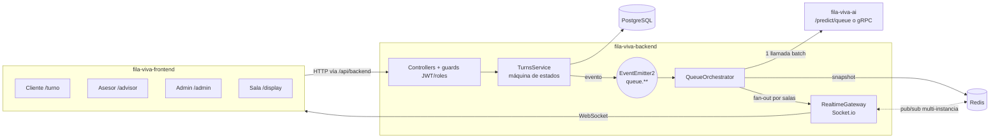

# Fila Viva — Backend

     

API central de **Fila Viva** para una sucursal bancaria ficticia (Banco Demo). Autentica al personal, gestiona turnos, asesores y trámites, le pide a la IA cuánto va a esperar cada persona y empuja ese dato en vivo a cada pantalla. Este repositorio es **uno de tres**:

| Repositorio | Qué hace | Puerto |
|---|---|---|
| [`fila-viva-backend`](https://github.com/JuanMaya8/fila-viva-backend) (este) | API central, orquestación y tiempo real | 3000 |
| [`fila-viva-frontend`](https://github.com/JuanMaya8/fila-viva-frontend) | Web/PWA del cliente, panel del asesor, panel del admin y pantalla de sala | 3001 |
| [`fila-viva-ai`](https://github.com/JuanMaya8/fila-viva-ai) | Modelos de ML + simulación de la cola | 8000 · gRPC 50051 |

**Demo en vivo:** [fila-viva-frontend.vercel.app](https://fila-viva-frontend.vercel.app) · API: [fila-viva-backend.onrender.com](https://fila-viva-backend.onrender.com/health) · IA: [fila-viva-ai.onrender.com](https://fila-viva-ai.onrender.com/health)

> Los servicios de Render usan el plan gratuito: si llevan un rato sin uso, la primera petición puede tardar cerca de un minuto mientras arrancan.

---

## 1. Arquitectura



**Flujo de un evento** (crear, cancelar, llamar, iniciar, ausente o finalizar un turno; actualizar el progreso; cambiar el estado de un asesor o la configuración):

1. El servicio de dominio guarda el cambio en PostgreSQL (con transacción y lock cuando corresponde) y publica un evento `queue.*` en EventEmitter2.
2. `QueueOrchestrator` lo recibe, carga el estado de la sucursal desde PostgreSQL y llama **una sola vez** a la IA (`POST /predict/queue`, o gRPC si `PREDICTION_TRANSPORT=grpc`).
3. Si la IA falla o tarda más de `PREDICTION_TIMEOUT_MS`, usa la estimación de respaldo (`source: "fallback"`). Crear un turno nunca falla por culpa de la IA.
4. Guarda el snapshot en Redis (`fv:queue:{institutionId}`). Si Redis no está, el snapshot se reconstruye desde PostgreSQL cuando se pide.
5. **Fan-out**: un snapshot se reparte solo a las salas afectadas (`turn:{id}` de cada turno abierto, `queue:{serviceTypeId}`, `display:{institutionId}`, `admin:{institutionId}`, `advisor:{agentId}`). Con `REDIS_URL`, el adaptador `@socket.io/redis-adapter` publica cada emisión en Redis y **todas las instancias** del backend la entregan a sus sockets.

Si llegan varios eventos mientras se recalcula, se agrupan en **una sola** corrida siguiente. Además, cada `QUEUE_REFRESH_SECONDS` se recalculan las sucursales con turnos abiertos, porque el tiempo transcurrido cambia el restante.

**Dónde entraría Kafka** (no está instalado a propósito): cada constante de `src/common/events/queue-events.ts` corresponde a un tópico (`queue.turn.created` → `fila-viva.turn.created`). Basta con reemplazar `eventEmitter.emit/emitAsync` por un productor Kafka y registrar `QueueOrchestrator` como consumidor; los payloads ya son JSON plano.

## 2. Modelo de datos

| Entidad | Para qué |
|---|---|
| `Institution` | Sucursal (código, nombre, zona horaria). Todo pertenece a una y se valida que exista |
| `User` | Admin o asesor que inicia sesión (contraseña con bcrypt, nunca se devuelve) |
| `Agent` | Perfil del asesor: ventanilla, estado (`available`, `busy`, `on_break`, `offline`), trámites que atiende |
| `ServiceType` + `ServiceStep` | Trámite configurable (nombre, prefijo del turno, duración media) y sus pasos |
| `Turn` | Turno con prioridad, asesor, marcas de llamado, inicio y fin, y la **predicción hecha al crearse** |
| `ServiceProgress` | Pasos completados, notas y bandera de caso complejo de la atención en curso |
| `PredictionLog` | Predicho vs. real al finalizar (espera y duración): alimenta el reentrenamiento y el tablero |

El esquema se crea **solo con migraciones** (`src/database/migrations`); no hay `synchronize`. `DropLegacySchema` elimina las tablas creadas con `synchronize` en la semana 3, que solo tenían datos ficticios, únicamente si detecta ese esquema viejo.

**Máquina de estados del turno** (`src/common/utils/turn-state-machine.ts`): `created → called → in_service → completed`, más `called → absent` y `created|called → cancelled`. Cualquier otra transición responde **409**.

**"Llamar siguiente"** es atómico: bloquea la fila del asesor (`FOR UPDATE`) y toma el turno con `FOR UPDATE SKIP LOCKED`, ordenando por preferencial, luego antigüedad, luego id. Dos asesores nunca obtienen el mismo turno, y la IA simula con la misma regla.

Un turno llamado que no se presenta en `ABSENT_TIMEOUT_MINUTES` se marca ausente automáticamente. Un asesor sin sockets abiertos durante `ADVISOR_DISCONNECT_GRACE_SECONDS` pasa a `offline` (si no está atendiendo). Ambas cosas recalculan la cola.

## 3. Seguridad

- **JWT** firmado con `JWT_SECRET` y guardado en cookie `fv_token` httpOnly, `SameSite=Lax`, `Secure` en producción. También se acepta `Authorization: Bearer` (Swagger).
- Guard global: todo requiere sesión salvo lo marcado con `@Public()`; `@Roles(...)` limita por rol. Si el usuario se desactiva, sus sesiones dejan de servir de inmediato.
- Públicos, solo: `GET /health`, `POST /auth/login`, `POST /auth/logout`, `GET /institutions`, `GET /service-types?institutionId=`, `POST /turns`, `GET /turns/:id`, `POST /turns/:id/cancel` (el id es un UUID imposible de adivinar) y `GET /display` (sin datos personales).
- Rate limit en login (`RATE_LIMIT_LOGIN_PER_MINUTE`) y en la creación pública de turnos (`RATE_LIMIT_TURNS_PER_MINUTE`).
- Helmet, y CORS de HTTP y WebSocket limitado a `FRONTEND_URL`.
- Los sockets de admin y asesor se autentican con un token de 5 minutos (`POST /auth/socket-token`).
- `/internal/history` exige `X-API-Key = INTERNAL_API_KEY`, la misma clave con la que el backend llama a la IA.
- Errores sin stack trace hacia el cliente (se registran en el servidor). Entradas validadas con class-validator (`whitelist` + `forbidNonWhitelisted`).
- El admin inicial sale de `ADMIN_EMAIL` / `ADMIN_PASSWORD` al correr el seed; nunca está en el código.

## 4. Endpoints

| Método | Ruta | Rol | Qué hace |
|---|---|---|---|
| POST | `/auth/login` · `/auth/logout` | público | Inicia o cierra sesión (cookie httpOnly) |
| GET | `/auth/me` | sesión | Usuario actual |
| POST | `/auth/socket-token` | sesión | Token corto para Socket.io |
| GET | `/institutions` | público | Sucursales (id, código, nombre) |
| GET | `/service-types?institutionId=` | público | Trámites activos con espera estimada actual |
| GET · POST · PATCH | `/service-types/manage` · `/service-types` · `/service-types/:id` | admin | Gestión de trámites y pasos |
| GET · POST · PATCH | `/agents` · `/agents/:id` | admin | Crear, editar, desactivar asesores |
| POST | `/agents/:id/reset-password` | admin | Restablecer contraseña |
| GET · PATCH | `/agents/me` · `/agents/me/status` | asesor | Panel propio; Disponible / En pausa |
| POST | `/turns` | público | Tomar turno (`preferential` opcional) |
| GET | `/turns/:id` · POST `/turns/:id/cancel` | público | Ver o cancelar el propio turno |
| GET | `/turns?serviceTypeId=` | admin, asesor | Fila con la posición real de cada turno |
| POST | `/turns/call-next` | asesor | Llamar siguiente (atómico) |
| POST | `/turns/:id/start` · `/absent` · `/complete` | asesor | Llegó · ausente · finalizar (`{ "callNext": true }`) |
| PATCH | `/turns/:id/progress` | asesor | Pasos, notas, caso complejo |
| GET | `/dashboard` · `/dashboard/model` | admin | Tablero e información del modelo |
| POST | `/dashboard/retrain` | admin | Reentrena la IA con el historial real |
| GET | `/display?institutionId=` | público | Pantalla de sala |
| GET | `/internal/history` | `X-API-Key` | Historial predicho vs. real para la IA |
| GET | `/health` | público | Estado de PostgreSQL y Redis |

Swagger con Bearer y cookie en <http://localhost:3000/docs>.

## 5. Cómo correrlo (Windows, PowerShell)

Requisitos: Node 20+, Docker Desktop (o PostgreSQL 16 y Redis instalados localmente).

```powershell
cd "C:\Users\Acer\Desktop\PROYECTO 1 Fil\fila-viva-backend"
docker compose up -d                 # PostgreSQL en 5433 y Redis en 6379
npm install
Copy-Item .env.example .env          # completa JWT_SECRET, INTERNAL_API_KEY, ADMIN_*
npm run seed                         # migraciones + sucursal + admin + 7 trámites
npm run start:dev                    # http://localhost:3000/docs
```

**Sin Docker**: instala PostgreSQL 16, crea el usuario y la base `filaviva` y ajusta `DB_HOST`, `DB_PORT` (5432), `DB_USERNAME` y `DB_PASSWORD`. Redis es opcional: deja `REDIS_URL=` vacío y el sistema usa solo PostgreSQL (y Socket.io en una sola instancia).

Migraciones:

```powershell
npm run migration:run
npm run migration:generate -- src/database/migrations/NombreDelCambio
npm run migration:revert
```

Tests:

```powershell
npm test            # 34 unitarios: estados, auth y guards, orden de llamada y fallback, orquestador
npm run test:e2e    # flujo principal con supertest sobre la base filaviva_e2e (se crea sola)
npm run lint
```

El e2e apaga la IA a propósito para comprobar que todo funciona con `source: "fallback"`.

## 6. Variables de entorno

Todas están documentadas en `.env.example`. Las imprescindibles son `JWT_SECRET`, `INTERNAL_API_KEY` (igual en la IA), `ADMIN_EMAIL`/`ADMIN_PASSWORD` (para el seed), `FRONTEND_URL` (puede ser una lista separada por comas) y la conexión a PostgreSQL (`DATABASE_URL` **o** `DB_*`). Opcionales: `REDIS_URL`, `PREDICTION_TRANSPORT=grpc` con `PREDICTION_GRPC_URL`, tiempos de cola y límites de tasa.

## 7. Despliegue (Render + Neon)

`render.yaml` crea el servicio. Antes de desplegar, configura en Render:

| Variable | Valor |
|---|---|
| `DATABASE_URL` | Cadena de conexión de Neon (secreta) |
| `INTERNAL_API_KEY` | La misma del servicio `fila-viva-ai` |
| `ADMIN_EMAIL` / `ADMIN_PASSWORD` | Credenciales del admin inicial |
| `FRONTEND_URL` | URL de Vercel, p. ej. `https://fila-viva-frontend.vercel.app` (más `http://localhost:3001` si quieres probar local) |
| `REDIS_URL` | Opcional (Render Key Value) |

`JWT_SECRET` lo genera Render. El arranque ejecuta `npm run seed:prod` (migraciones e inserción idempotente) y luego la API. **Ojo:** el primer despliegue elimina las tablas de demo creadas con `synchronize` (migración `DropLegacySchema`), que solo contenían datos ficticios.

## 8. Datos de demostración simulados

> **Aviso:** estos datos son **SIMULADOS**. Sirven para que el tablero y el reentrenamiento tengan historial, y deben presentarse como datos simulados, nunca como atenciones reales.

`scripts/seed-demo-history.js` llena la tabla `prediction_logs` con atenciones simuladas. El resultado "real" (espera y duración) sale de un modelo de colas que la IA no conoce; las predicciones sí son reales: cada fila se predice llamando al servicio `fila-viva-ai` (`/predict` y `/predict/remaining`), igual que con un turno real. Todas las filas quedan marcadas con `prediction_source = 'sim:...'`, así se distinguen de los turnos reales y se pueden borrar con `--clear`. El script vive fuera de `src/`, por lo que no entra al build de producción ni al lint.

Variables (no las guardes en el repositorio):

| Variable | Uso |
|---|---|
| `DATABASE_URL` | Cadena de conexión de PostgreSQL (en producción, la de Neon). No hace falta con `--dry-run`. |
| `INTERNAL_API_KEY` | La misma clave de `fila-viva-ai`. |
| `AI_URL` | Opcional. Por defecto `https://fila-viva-ai.onrender.com` (también se puede pasar `--ai-url`). |

```powershell
$env:DATABASE_URL = "postgres://..."      # pégala solo en tu terminal
$env:INTERNAL_API_KEY = "..."

# Probar sin escribir nada: genera, predice y muestra el resumen
npm run seed:demo-history -- --dry-run

# Insertar 600 atenciones simuladas repartidas en los últimos 30 días
npm run seed:demo-history -- --rows 600

# Borrar todas las filas simuladas (solo las sim:...)
npm run seed:demo-history -- --clear

# Al terminar, limpia las variables de la sesión
Remove-Item Env:DATABASE_URL, Env:INTERNAL_API_KEY
```

Otras opciones: `--days N` (por defecto 30) y `--seed N` (por defecto 7; misma semilla, mismos datos). Después de insertar, reentrena desde **Admin › Tablero › Modelo IA** y recarga el tablero.

## 9. Contratos entre servicios

Todos los campos van en camelCase. Las definiciones viven en el código: Pydantic en [`fila-viva-ai/app/schemas.py`](https://github.com/JuanMaya8/fila-viva-ai/blob/main/app/schemas.py), TypeScript en [`fila-viva-backend/src/modules/prediction/interfaces/`](https://github.com/JuanMaya8/fila-viva-backend/tree/main/src/modules/prediction/interfaces) y [`fila-viva-frontend/src/lib/types.ts`](https://github.com/JuanMaya8/fila-viva-frontend/blob/main/src/lib/types.ts). El contrato gRPC equivalente está en `proto/fila_viva_prediction.proto` (igual en la IA y en el backend).

<details>
<summary><strong>Ver los contratos JSON completos</strong></summary>

### Backend → IA (todas las rutas excepto `/health` llevan el header `X-API-Key: <INTERNAL_API_KEY>`)

**`POST /predict/queue`**: una llamada por evento de la cola, con toda la sucursal. Los turnos cuyo `turnId` empieza por `probe:` son hipotéticos ("si alguien llega ahora") y alimentan la espera estimada que se muestra antes de tomar turno.

```json
{
  "timestamp": "2026-11-03T15:30:00.000Z",
  "utcOffsetMinutes": -300,
  "serviceTypes": [
    { "id": "6f1c9a52-6a4e-4d5e-9a57-2a0f2b7c1a10", "avgServiceMinutes": 3, "stepsTotal": 3 },
    { "id": "0b8e4d3c-2f7a-4b61-8d2e-91c5a7e4f220", "avgServiceMinutes": 35, "stepsTotal": 6 }
  ],
  "advisors": [
    {
      "id": "a3d2c1b0-1111-4c2d-9e8f-0a1b2c3d4e5f",
      "status": "busy",
      "serviceTypeIds": ["6f1c9a52-6a4e-4d5e-9a57-2a0f2b7c1a10", "0b8e4d3c-2f7a-4b61-8d2e-91c5a7e4f220"],
      "speedFactor": 1.0,
      "statusSinceSeconds": 240,
      "currentTurn": {
        "turnId": "5e0f7a1c-2222-4b3c-8d4e-5f6a7b8c9d0e",
        "serviceTypeId": "0b8e4d3c-2f7a-4b61-8d2e-91c5a7e4f220",
        "status": "in_service",
        "elapsedSeconds": 600,
        "stepsCompleted": 2,
        "stepsTotal": 6,
        "isComplex": false
      }
    }
  ],
  "waitingTurns": [
    {
      "turnId": "9c8b7a6d-3333-4e5f-8a9b-0c1d2e3f4a5b",
      "serviceTypeId": "6f1c9a52-6a4e-4d5e-9a57-2a0f2b7c1a10",
      "preferential": false,
      "createdAt": "2026-11-03T15:21:00.000Z"
    },
    {
      "turnId": "probe:6f1c9a52-6a4e-4d5e-9a57-2a0f2b7c1a10",
      "serviceTypeId": "6f1c9a52-6a4e-4d5e-9a57-2a0f2b7c1a10",
      "preferential": false,
      "createdAt": "2026-11-03T15:30:00.000Z"
    }
  ]
}
```

```json
{
  "source": "model",
  "modelVersion": "lgbm-20261104001134",
  "congestionLevel": "medium",
  "turns": [
    {
      "turnId": "9c8b7a6d-3333-4e5f-8a9b-0c1d2e3f4a5b",
      "peopleAhead": 0,
      "estimatedWaitMinutes": 18.4,
      "lowerMinutes": 11.4,
      "upperMinutes": 29.2,
      "confidence": 57,
      "traditionalEstimateMinutes": 0.0,
      "congestionLevel": "medium"
    },
    {
      "turnId": "probe:6f1c9a52-6a4e-4d5e-9a57-2a0f2b7c1a10",
      "peopleAhead": 1,
      "estimatedWaitMinutes": 21.8,
      "lowerMinutes": 14.4,
      "upperMinutes": 33.7,
      "confidence": 58,
      "traditionalEstimateMinutes": 10.8,
      "congestionLevel": "medium"
    }
  ],
  "inService": [
    {
      "turnId": "5e0f7a1c-2222-4b3c-8d4e-5f6a7b8c9d0e",
      "remainingMinutes": 19.4,
      "lowerMinutes": 11.5,
      "upperMinutes": 33.4,
      "expectedTotalMinutes": 29.4
    }
  ]
}
```

`source` vale `model` (modelos entrenados), `baseline` (M/M/c dentro de la IA) o `fallback` (estimación del backend cuando la IA no responde). `peopleAhead` cuenta los turnos del mismo trámite que se llamarán antes (preferencial primero, luego el más antiguo). `traditionalEstimateMinutes` = `peopleAhead × 10.8`.

**`POST /predict/remaining`**: tiempo restante de una atención en curso.

```json
{
  "avgServiceMinutes": 25,
  "stepsTotal": 6,
  "stepsCompleted": 3,
  "elapsedSeconds": 720,
  "isComplex": false,
  "advisorSpeedFactor": 1.0,
  "timestamp": "2026-11-03T15:30:00.000Z",
  "utcOffsetMinutes": -300
}
```

```json
{
  "remainingMinutes": 9.4,
  "lowerMinutes": 5.0,
  "upperMinutes": 16.9,
  "expectedTotalMinutes": 21.4,
  "source": "model",
  "modelVersion": "lgbm-20261104001134"
}
```

**`POST /predict`**: contrato original de la semana 3, se mantiene (`avgServiceMinutes` es opcional).

```json
{
  "peopleAhead": 8,
  "activeAgents": 3,
  "serviceTypeId": "2b6f8c2e-1b3a-4a3a-9d90-7d6a0f9b6a11",
  "arrivalTime": "2026-09-29T14:32:00.000Z"
}
```

```json
{
  "estimatedWaitMinutes": 36,
  "confidence": 73,
  "traditionalEstimateMinutes": 86,
  "congestionLevel": "high"
}
```

**IA → Backend: `GET /internal/history`** (header `X-API-Key`), usado por `POST /train` para mezclar datos reales:

```json
{
  "count": 1,
  "records": [
    {
      "serviceTypeId": "6f1c9a52-6a4e-4d5e-9a57-2a0f2b7c1a10",
      "agentId": "a3d2c1b0-1111-4c2d-9e8f-0a1b2c3d4e5f",
      "avgServiceMinutes": 3,
      "stepsTotal": 3,
      "isComplex": false,
      "startedAt": "2026-11-03T15:31:00.000Z",
      "actualServiceMinutes": 2.6,
      "predictedServiceMinutes": 3.1,
      "actualWaitMinutes": 4.2,
      "predictedWaitMinutes": 3.4,
      "traditionalWaitMinutes": 10.8
    }
  ]
}
```

### Backend → Frontend

**Turno (`POST /turns`, `GET /turns/:id`, evento `turnUpdate`)**:

```json
{
  "id": "9c8b7a6d-3333-4e5f-8a9b-0c1d2e3f4a5b",
  "ticketNumber": 12,
  "ticketCode": "C-012",
  "status": "created",
  "serviceTypeId": "6f1c9a52-6a4e-4d5e-9a57-2a0f2b7c1a10",
  "serviceTypeName": "Consulta rápida",
  "preferential": false,
  "peopleAhead": 2,
  "estimatedWaitMinutes": 6.4,
  "lowerMinutes": 3.9,
  "upperMinutes": 9.8,
  "confidence": 74,
  "traditionalEstimateMinutes": 21.6,
  "congestionLevel": "low",
  "source": "model",
  "windowNumber": null,
  "createdAt": "2026-11-03T15:21:00.000Z",
  "calledAt": null,
  "estimatedAt": "2026-11-03T15:30:00.000Z"
}
```

Estados del turno: `created → called → in_service → completed`, más `absent` (desde `called`) y `cancelled` (desde `created` o `called`). Cualquier otra transición responde **409**.

**Socket.io** (URL `NEXT_PUBLIC_WS_URL`):

| El cliente emite | Sala | El servidor emite | Contenido |
|---|---|---|---|
| `joinTurn(turnId)` | `turn:{id}` | `turnUpdate` | Turno (arriba) |
| `joinQueue(serviceTypeId)` | `queue:{serviceTypeId}` | `queueUpdate` | Resumen de la fila: `waiting`, `activeAdvisors`, `estimatedWaitMinutes`, `confidence`, `congestionLevel` |
| `joinDisplay(institutionId)` | `display:{institutionId}` | `displayUpdate` | Turnos llamados con ventanilla, próximos turnos y espera por trámite (sin datos personales) |
| handshake `auth.token` de admin | `admin:{institutionId}` | `dashboardUpdate` | Tablero del admin |
| handshake `auth.token` de asesor | `advisor:{agentId}` | `advisorUpdate` | Panel del asesor |

El token de socket se obtiene con `POST /auth/socket-token` (dura 5 minutos), porque la cookie de sesión es httpOnly. Cada `join*` tiene su `leave*`.

</details>

## 10. Convenciones del proyecto

- Código, comentarios y commits en inglés; los README en español.
- Cada módulo sigue el patrón `entities/`, `dto/`, `*.service.ts`, `*.controller.ts`, `*.module.ts`.
- Nada de lógica de predicción aquí, salvo `fallback-estimator.ts`, que solo actúa cuando la IA no responde.
- Un cambio de esquema siempre va con una migración. No reactivar `synchronize`.
- Si cambia la regla de "llamar siguiente", cámbiala también en la simulación de la IA (`app/simulation.py`).
